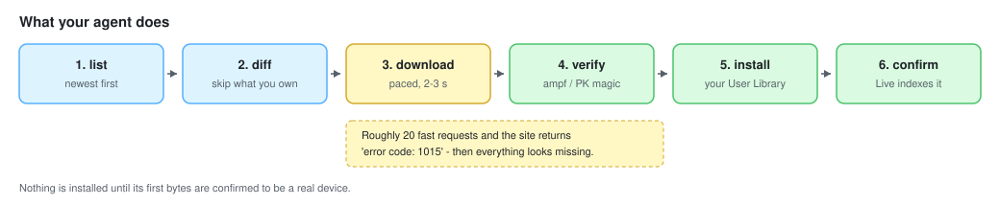

# maxforlive-harvester

[](LICENSE)


Find free synths and effects for Ableton Live with your coding agent. [Browse a real catalog of 410 installed devices](examples/CATALOG.md). For example, look up **D-Emu1.0** for a Minimoog-style bass or lead.

## Try it on one device

You’ll need Ableton Live with Max for Live (open Live at least once), an agent with web and shell access, and Node for this install command.

```bash
npx skills add Justinandjohnson/maxforlive-harvester
```

Then ask your agent:

> Find one free Max for Live bass synth. Show me the source page and wait for me to pick it before downloading.

Once you pick one, ask the agent to install it and tell you where it landed in your Live User Library. Open the device in Live to try it in a set.

Want to show what you found? Follow the [20-second demo recording checklist](docs/record-a-demo.md).

The CLI installs the skill into `.agents/skills/` for Codex and Cursor. Claude Code users should use the latest skills CLI because version 1.5.15 and earlier skip the Claude skill link.

<details>
<summary>Other ways to install, and what you need</summary>

- **Claude Code / OpenCode:** copy `skills/maxforlive-harvester/` into `~/.claude/skills/` or `~/.config/opencode/skills/`
- **Codex:** copy `skills/maxforlive-harvester/` into `~/.agents/skills/` (or `.agents/skills/` in a project). Codex reads `SKILL.md`; the repo-root `AGENTS.md` only applies inside a checkout of this repo
- **Any other agent:** point it at `skills/maxforlive-harvester/SKILL.md` — that file is the whole skill

The `npx` line needs Node. If you don't have it, copy the folder by hand.

**What you need either way:** an agent that can browse web pages and run shell
commands, plus Ableton Live with Max for Live, started at least once. Nothing else —
no runtime, no package to install. The skill hands your agent the command for
whichever shell you already have (PowerShell on Windows, bash on macOS).

</details>

There are **no scripts, no installer, no build step** — markdown plus two JSON
indexes.



## What this is

| File | Role |
| --- | --- |
| `skills/maxforlive-harvester/SKILL.md` | **The whole skill.** Self-contained — every path, URL, check and rule is in this one file. |
| `skills/maxforlive-harvester/seed/known-devices.json` | Optional. 877 devices from a previous harvest, so repeat runs skip them. The skill works without it. |
| `examples/CATALOG.md` | Sample output — 410 devices sorted by what they do. |
| `docs/*.svg` | The charts on this page. |

**To share this with someone, `SKILL.md` is enough on its own.** Drop that one file in
a skills folder and it works. The seed folder is a speed-up, not a dependency. There
are no scripts, no installer, no build step and no runtime.

## Use when

- you want the good free devices without clicking through hundreds of pages
- you want releases since last time, not the whole catalogue again
- a previous attempt said "File not found" for everything — that's usually the
  site's rate limiter, not missing files
- you need M4L devices added without spending money or tripping a bot wall

## What it does

A from-scratch harvest is paced at 2–3 seconds per request to stay under the site's
rate limiter, so it runs for a while — budget an hour or more, and assume it's
working unless it says otherwise. Repeat runs against the index take minutes.

| You want | You say | You end up with |
| --- | --- | --- |
| Free devices, from scratch | "harvest the free M4L devices" | A full library, every file verified |
| Only what's new | "what's new since last time" | A short list of releases, then just those |
| Devices whose authors moved to a store front | "get the free ones off Gumroad" | The **$0** ones only — it never buys |
| To know what you own | "catalogue my M4L devices" | A list sorted by what each one does |

## What it won't do

- **Packs.** `.alp` files are a proprietary container. It leaves them in Downloads
  and tells you to drag them onto Live.
- **Demo tiers.** When the only $0 option is a demo, you get the demo, folder-named
  as a demo. The full version is not bought.
- **Store downloads that aren't devices.** A few free store zips contain VST3s
  rather than `.amxd`. Those come back as a note, not an install.
- **Your Gumroad account.** Some free orders still land in a Gumroad Library behind
  a login, and a couple of $0 checkouts want a postal address. Those are reported
  as blocked, not invented around.
- **Your card.** It types the email you give it into Gumroad's checkout. It never
  types card details, and never pays for anything.

## It knows what it's doing

877 devices are indexed with their outcome already recorded — 321 downloaded, 280
gone from the site, 263 priced and not bought, 7 not for sale, 6 blocked.


**"Gone" means the site no longer hosts a file for that device** — the index has no
store link for those 280 either. **"Priced" means it was behind a real price and was
deliberately not bought.** Checkouts happen only when the cart total is 0.00 — it
checks the cart, not the listing, because a "$0+" item was seen totalling $5.49.

**The index is a record of one earlier harvest, not a scan of your library.** It
saves fetching. It cannot tell you what you own.


That chart is the author's own 410-device library, catalogued well before this
harvest — not the output of a single run. Full sample:
[`examples/CATALOG.md`](examples/CATALOG.md).

## Platform status

Run end to end on **Windows 11**. The macOS paths come from Ableton's own indexer
log format and have not been through a full harvest here — if you hit something, an
issue with your error output is genuinely useful. **Linux is not supported**: Live
doesn't run there, so the whole premise (reading Live's indexer log) doesn't apply.

<details>
<summary>Why it reads Live's indexer log instead of guessing the path</summary>

`~/Documents` is often redirected into OneDrive or iCloud. Writing devices into
`Documents/Ableton/User Library` while Live indexes `OneDrive/Documents/...`
produces installs that succeed and never appear. The skill tells the agent to read
Live's own indexer log and use the path it reports — that guidance is in step 2 of
`SKILL.md`.

</details>

<details>
<summary>Related work, and why this isn't an Ableton Extension</summary>

- [thereplicants/ableton-package-manager](https://github.com/thereplicants/ableton-package-manager) — manages devices you already have; does not fetch them
- [mgarbvs/m4l-github-updater](https://github.com/mgarbvs/m4l-github-updater) — updates installed devices from GitHub
- [Ronvaknins/ableton-extensions-skill](https://github.com/Ronvaknins/ableton-extensions-skill) — builds Ableton Extensions

Harvesting is HTTP, rate limiting and byte checks — all of which work with Live
closed. Wrapping it in an Extension would put an SDK and a Node toolchain in the path
of work that doesn't need either.

</details>

## License

MIT — see [LICENSE](LICENSE). Not affiliated with Ableton AG, Cycling '74, maxforlive.com or Gumroad.
