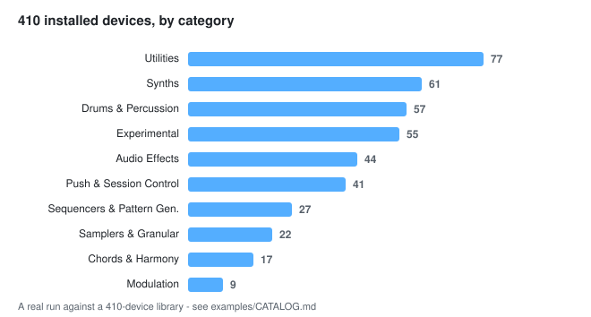
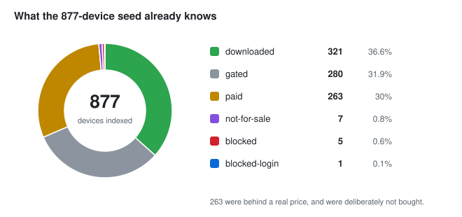

# maxforlive-harvester

[](LICENSE)


**An agent skill that fills your Ableton User Library with free Max for Live devices — without clicking 400 pages.**


## Install

```bash
npx skills add Justinandjohnson/maxforlive-harvester
```

That drops it into `.agents/skills/`, which Claude Code, Codex, Cursor and OpenCode all read. Add `-g` to install for every project.

Then just ask your agent:

```text
Use maxforlive-harvester to refresh my Max for Live library
```

<details>
<summary>Other install paths</summary>

- **Claude Code / OpenCode (manual):** copy `skills/maxforlive-harvester/` into `~/.claude/skills/` or `~/.config/opencode/skills/`
- **Codex:** copy into `~/.agents/skills/` — `AGENTS.md` at the repo root is the entry point
- **No agent?** Run the scripts directly — see `skills/maxforlive-harvester/SKILL.md`

Every script is plain PowerShell. Nothing is installed, nothing is uploaded, no telemetry.

</details>

## Use

```bash
cp skills/maxforlive-harvester/config.example.json skills/maxforlive-harvester/config.json
pwsh skills/maxforlive-harvester/scripts/detect-library.ps1
```

```console
$ pwsh scripts/diff-known.ps1
seed: 877 known devices
page 0 -> 9 listed, 2 new so far

=== 2 NEW devices not in the seed ===
id     posted        name                author
17308  Nov 19 2026   POLYRING 11 DEMO    TTMC
17309  Nov 19 2026   GOA ACID            TTMC
```

It already knows what you have, so a refresh costs seconds instead of hours. Then harvest just those:

```bash
pwsh scripts/build-queue.ps1 -Ids 17308,17309
pwsh scripts/run.ps1 -Install
```

**Use when:**

- your User Library was wiped and you want the good free devices back
- you want new releases since last time, not the whole catalogue again
- a previous run returned "File not found" for everything — that is usually the site's rate limiter, not missing files
- you need M4L devices added without spending money or tripping a bot wall

## What you get

| You want | The agent runs | You end up with |
| --- | --- | --- |
| Everything free, from scratch | `run.ps1 -Install` | A full library, every file verified |
| Only what is new | `diff-known.ps1` | A short list of releases since last run |
| Devices whose authors moved to Gumroad | `gumroad-next.ps1` | The **free** ones, $0 checkouts only |
| To know what you own | `categorize.ps1` | A catalogue sorted by what each device does |



## It knows what it is doing

877 devices are indexed with their outcome already known — so it never re-fetches, and never pretends a paywall was a failure.



**263 of those were behind a real price and were deliberately not bought.** The tool completes a checkout only when the cart total is 0.00, checks that total rather than the listing (a "$0+" item was seen totalling $5.49), and asks you for your email instead of shipping with one.

## Requirements

- **PowerShell 5.1+** on Windows, or **PowerShell 7 (`pwsh`)** on macOS/Linux — `pwsh` is not preinstalled on macOS
- **curl** (bundled with Windows 10+ and macOS)
- **Ableton Live** with Max for Live, started at least once

> **Tested on Windows only.** The macOS paths are implemented but have never been run. If you hit something, an issue with your error output is genuinely useful.

<details>
<summary>Why it detects your User Library instead of guessing</summary>

`~/Documents` is often redirected into OneDrive. Writing devices into `Documents\Ableton\User Library` while Live indexes `OneDrive\Documents\...` produces installs that succeed and never appear. The detector reads Live's own indexer log and warns when a second library exists.

</details>

<details>
<summary>Related work, and why this is not an Ableton Extension</summary>

- [thereplicants/ableton-package-manager](https://github.com/thereplicants/ableton-package-manager) — manages devices you already have; does not fetch them
- [mgarbvs/m4l-github-updater](https://github.com/mgarbvs/m4l-github-updater) — updates installed devices from GitHub
- [Ronvaknins/ableton-extensions-skill](https://github.com/Ronvaknins/ableton-extensions-skill) — builds Ableton Extensions

Harvesting is HTTP, rate limiting and file validation — all of which work with Live closed. An Extension would add a Node ≥24 toolchain and a beta SDK to save about thirty seconds.

</details>

## License

MIT — see [LICENSE](LICENSE). Not affiliated with Ableton AG, Cycling '74, maxforlive.com or Gumroad.
